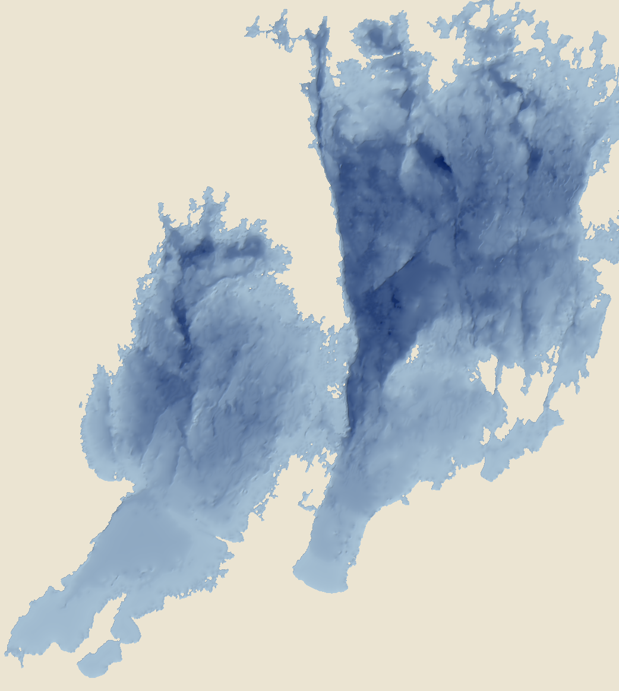

# Vänerns djup – digital djupmodell

Fri djupmodell över hela Vänern (25 m-rutnät) och djupkurvor var 10:e meter, framtagna ur SMHI:s
skannade djupkarta från 1977.



> **Får inte användas för navigation.** Modellen bygger på en karta från 1977 med 10 m-djupklasser.
> Djupet mellan kurvorna är uppskattat (interpolerat). För sjöfart: använd Sjöfartsverkets sjökort.

## Innehåll

| Fil | Beskrivning |
|---|---|
| `data/vanern_djup_25m.tif` | Djupmodell, molnoptimerad GeoTIFF (COG). SWEREF 99 TM (EPSG:3006), 25 m upplösning, 4 167 × 4 656 celler. Värde = djup i meter under sjöns medelvattenyta (positivt nedåt). Land och öar = NoData. |
| `data/vanern_djupkurvor_10m.gpkg` | Djupkurvor 10, 20 … 100 m (GeoPackage, lager `djupkurvor`, fält `djup_m`), framtagna ur djupmodellen. |
| `qgis/Vänerns djup.qlr` | Färdig lagergrupp för QGIS (dra in filen i QGIS): djupkurvor, skuggad botten och djupfärg. Pekar på filerna i `data/` med relativa sökvägar. |
| `qgis/vanern_djup_25m.qml` | QGIS-stil för djupmodellen (kontinuerlig färg 0–106 m, utjämnad läsning). Lägg den bredvid tif-filen så används den automatiskt, eller läs in den under Lageregenskaper → Stil. |
| `qgis/vanern_djupkurvor_10m.qml` | QGIS-stil för djupkurvorna: tunna var 10:e meter, tjockare var 50:e, diskreta djuptal utan halo, referensskala 1:10 000. |
| `qgis/vanern_djup_fargskala.xml` | Färgskalan "Vänern djup (0–106 m)" för QGIS stilhanterare (Importera/exportera → Importera). |
| `qgis/prov_fargskala.png` | Provbild av färgskalan. |
| `kalla/0-0156_Vanern_SMHI_647666-129906.jpg` | Originalskanningen från SMHI (oförändrad). |
| `skript/` | Python-skripten som gjort bearbetningen (se nedan). |
| `skript/webbkarta/` | Skript som gör rasterrutor och 3D-terräng för en webbkarta. De använder Lantmäteriets Topografi 10, som inte ingår här. |

Färgskalan går från ljust turkos vid stranden (`#e8f6fc`) till mörkt marinblått i de djupaste
groparna (`#071a3c`), med tätare steg i grunt vatten.

I QLR:en läses rastret med kubisk utjämning när man zoomar in (annars ritar skuggningen ett rutnät
efter 25 m-cellerna). Skuggningen använder negativ höjdfaktor eftersom djupet är positivt nedåt, och
blandningsläget Multiplicera. Djupkurvorna jämnas ut vid ritning och djuptalen visas bara i skalor
större än 1:60 000, på kurvor längre än 2,5 km.

Bottnens höjd över havet (RH 2000) fås ungefär som Vänerns vattenstånd (cirka 44 m, varierar med
året) minus värdet i modellen.

## Källa

**SMHI, Svenskt vattenarkiv (SVAR)**, objekt 647666-129906, hämtat via
[SMHI Vattenwebb](https://vattenwebb.smhi.se/svarwebb/) 2026-10-28, licens
[CC BY 4.0](https://creativecommons.org/licenses/by/4.0/deed.sv).

Kartan: *Vänern – djupkarta med 10 m ekvidistans / Lake Vänern – bathymetric map with 10 m contour
interval*, Liber Kartor, Stockholm 1977, skala 1:180 000 (Mercatorprojektion). Sammanställd av docent
Lars Håkanson, Naturvårdsverkets limnologiska undersökning.

## Metod

1. **Gradnätet** (`graticule.py`): kartans 13 meridianer och parallellcirklar (12°20′–14°00′ var 20′,
   58°20′–59°20′ var 10′) hittas automatiskt i skanningen. Medelfel cirka 1 pixel (≈ 11 m i terrängen).
2. **Färgklassning** (`classify.py`): tryckrastret jämnas ut och varje pixel får närmaste färg i kartans
   färgförklaring (elva klasser, 0–10 … 100–106 m) eller land. Text, linjer och symboler fylls med
   omgivande klass.
3. **Djup och georeferering** (`depth.py`): bara den sammanhängande sjöytan behålls; klassregioner
   som saknar grannklass rättas (text och symboler i sjön); djupet inom en klass interpoleras utifrån
   avståndet till grundare och djupare klass; små orimligt djupa fläckar (hamnsymboler) tas bort.
   De 42 skärningspunkterna i gradnätet ger ett andragradspolynom från (longitud, Mercator-y) till
   pixel (medelfel 15 m).
4. **Justering mot Lantmäteriet**: kartans gradnät bygger på ett äldre referenssystem. Vid jämförelse
   med Topografi 10:s strandlinje i Lidköpings kommun låg modellen 175 m för långt österut och 50 m
   för långt norrut. Efter justeringen överlappar sjöytan Lantmäteriets till 96,5 % inom kommunen.
   Körning: `python depth.py <arbetsmapp> 25 -175 -50`.

Skripten körs med en Python som har numpy, scipy, GDAL, pyproj och Pillow (till exempel QGIS egen).
Körordning, med en tom arbetsmapp `arbete`:

```bash
python skript/graticule.py kalla/0-0156_Vanern_SMHI_647666-129906.jpg arbete/graticule.json
python skript/classify.py kalla/0-0156_Vanern_SMHI_647666-129906.jpg arbete
python skript/depth.py arbete 25 -175 -50
python skript/export_release.py arbete/vanern_djup_25m.tif data
python skript/make_ramp.py data/vanern_djup_25m.tif qgis      # kräver QGIS Python (python-qgis.bat)
python skript/make_qgis_styles.py .                            # QML-stilar och QLR, kräver QGIS Python
```

Pixelkoordinaterna för färgförklaring, land och ram i `classify.py` och gradnätet i `graticule.py`
gäller just den här skanningen.

## Kontroll

| | Modellen | SMHI |
|---|---|---|
| Medeldjup | 28,3 m | 27 m |
| Största djup | 100,5 m | 106 m |
| Sjöyta | cirka 5 460 km² | 5 448 km² (djupkartan) |

Största djupet blir lite för litet eftersom de djupaste groparna är små och utjämnas.

## Begränsningar

- Kartan är från 1977. Strandlinje, hamnar och muddrade områden kan ha ändrats.
- Djupklasserna är 10 m breda. Mellan kurvorna är djupet uppskattat, inte uppmätt.
- Strandlinjen följer den grova kartan (cirka 25–50 m noggrannhet). Använd en modern strandlinje,
  till exempel Lantmäteriets, om du behöver exakt kant.
- Smala vikar, älvmynningar och små öar kan saknas eller vara förenklade.

## Licens

- **Data** (`data/`, `kalla/`, `qgis/`, `oversikt.png`): [CC BY 4.0](LICENSE-data). Ange källan, till exempel:
  *"Vänerns djup: bearbetning av SMHI:s djupkarta (Svenskt vattenarkiv, Liber Kartor 1977), CC BY 4.0."*
- **Skript** (`skript/`): [MIT](LICENSE-skript).

---

## In English

A free bathymetric model of Lake Vänern, Sweden (25 m grid, SWEREF 99 TM / EPSG:3006, depth in metres
below mean lake level) and 10 m depth contours. It was digitised from SMHI's scan of the 1977 bathymetric
map by L. Håkanson (Liber Kartor, 1:180 000, CC BY 4.0) using colour classification, distance-based
interpolation between the contours and georeferencing against the map's graticule. A 175 m W / 50 m S
shift aligns it with Lantmäteriet's modern shoreline. Data: CC BY 4.0. Scripts: MIT.
**Not for navigation.**
